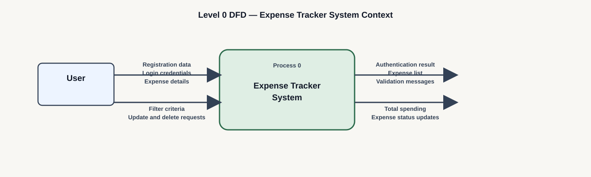
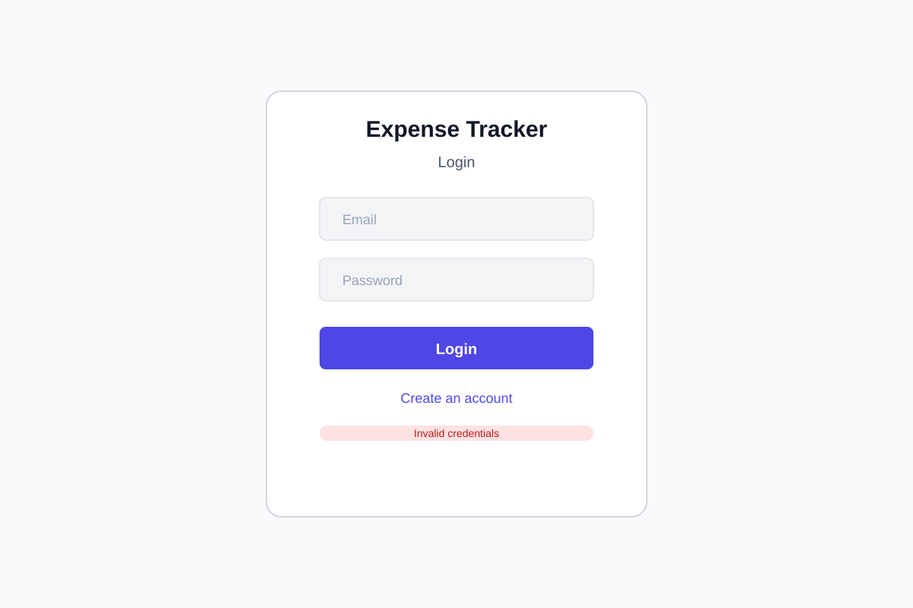
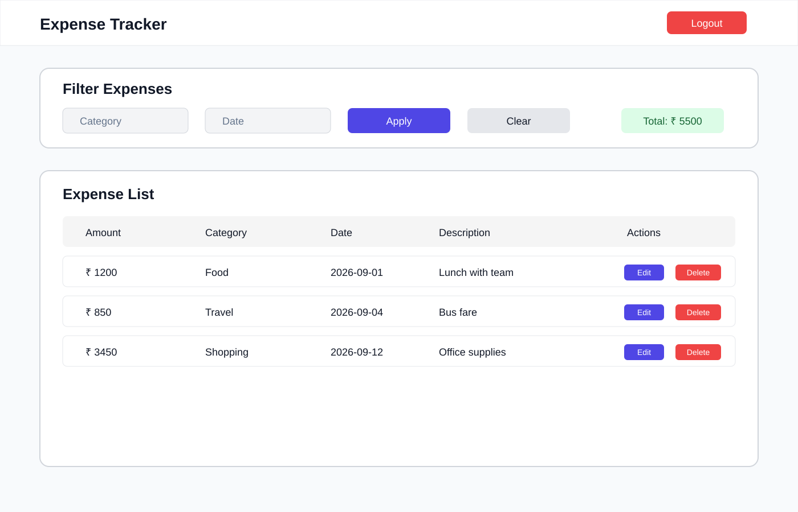
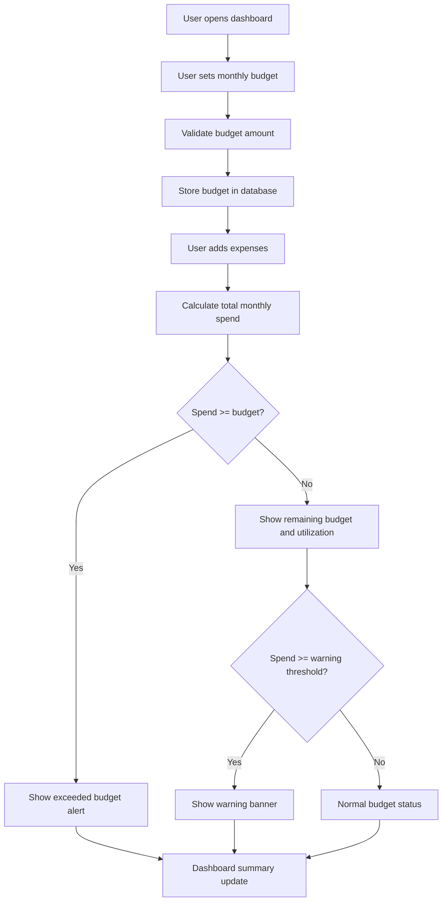
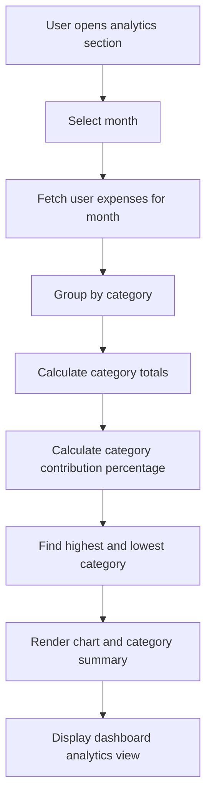

# Design Visuals

This file contains the design diagrams and data-flow visuals as wireframe-style pictures for the Expense Tracker project.

## 1. High-Level Architecture for a Small Expense Tracker

This architecture is designed for a lightweight application and includes only the layers that are actually required:

- Users / Clients
- Frontend Applications
- API Gateway (optional, not required for the direct Flask route design)
- Backend Services
- Business Logic Components
- Databases
- Security and Authorization
- Storage
- Monitoring
- Deployment Environments
- High-Level Technology Stack

## 2. Architecture Diagram

## 3. Level 0 DFD — Business Context

## 4. Level 1 DFD — Business System

## 5. Login Wireframe

## 6. Expense Dashboard Wireframe

These visuals are intentionally kept simple, presentation-friendly, and aligned with the Expense Tracker business system and its core data flows.

## 7. Version 2 Monthly Budget Tracking Flow

This flow explains the user experience for monthly budget configuration,
remaining balance calculation, warning state management, and the final
visual status shown on the dashboard.

## 8. Version 2 Category Analytics Flow

This flow shows how the system aggregates user expenses into category-level
insights, computes percentages, and presents the results in a readable and
decision-supportive dashboard layout.

## 9. Version 2 UI Interpretation

The Version 2 visual design continues the same lightweight and practical
approach as the original project. It adds dashboard cards for budget status,
remaining balance, utilization percentage, and category charts without
changing the basic user interaction style or the core Expense Tracker
workflow.
