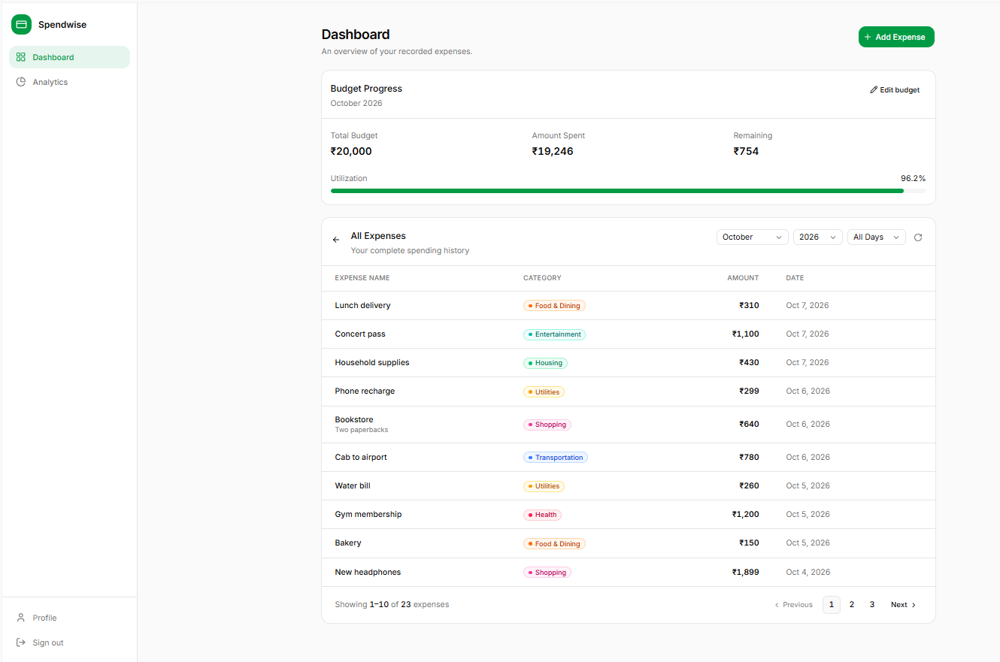
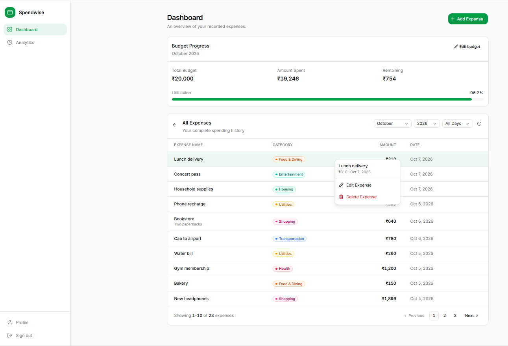
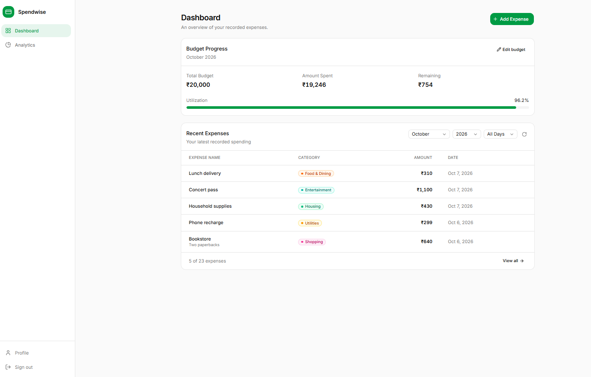
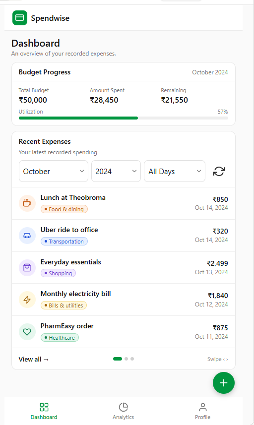

# Expense Tracker Design

## Overview

The application is a small server-rendered personal expense tracker using
Flask, SQLite, HTML, CSS, and lightweight JavaScript.

## Architecture

1. The browser renders Flask templates and submits forms.
2. Flask handles authentication, CSRF checks, validation, ownership checks,
   calculations, and route behavior.
3. SQLite stores users, categories, expenses, and budgets.

The browser does not access SQLite directly.

### Phase 1 AI Assistant

The assistant extends this architecture as a read-only, authenticated feature:

**User → Chat UI → Backend Chat Endpoint → User-scoped Data Retrieval →
Provider-independent AI Service / Model → Response**

The backend retrieves only the signed-in user's relevant financial data before
passing summarized context to the AI service. This addition does not change the
existing expense, budget, Dashboard, authentication, or Analytics flows. See
[requirements.md](requirements.md) for the detailed feature contract.

## Data model

- **User**: case-sensitive unique username, password hash, and role (Student,
  Homemaker, or Professional).
- **Category**: user-owned display name and normalized comparison name.
- **Expense**: user, amount, category ID and display name, ISO date, optional
  description.
- **Budget**: user, month, year, amount, creation and update timestamps.


## Presentation

- Login and Register provide account access.
- Dashboard displays current-month budget metrics, status, recent expenses, and
  budget controls.

- Add Expense is a shared popup opened after login and from authenticated
  Add Expense actions. It follows the AddExpense visual: Amount, role-specific
  Category dropdown, Today/Yesterday/custom Date controls, optional
  Description, and Save.
- Expenses provides the complete unfiltered ledger, category filter, and
  expense list.

- Selecting an expense displays the available expense actions:
  - Edit
  - Delete

- Edit opens the Add Expense page with the selected expense's existing
  amount, category, date, and description pre-populated for modification.

- Delete displays a confirmation dialog before the expense is permanently
  removed.

- After a successful edit or delete operation, the expense list refreshes
  automatically while preserving active filters.
- Analytics provides year/month/day/category selection, selected-period
  spending metrics, a category distribution, and a monthly spending-versus-
  budget chart for the selected year.

### Add Expense popup hierarchy

1. Popup heading and close action.
2. Amount and the signed-in user's role-specific Category dropdown.
3. Date controls with only Today, Yesterday, and a custom date picker; Today is
   active by default.
4. Optional Description and Save action.
5. Validation feedback remains in the popup; a successful save displays a
   confirmation and resets the form after acknowledgment.


All authenticated pages share the same navigation and responsive styling.

## Validation and business rules

- Amounts must be finite, positive, and have at most two decimal places.
- Expense dates must be valid and no later than today. Both browser and server
  enforce this restriction.
- Analytics year/month selections cannot be later than the current month/year;
  day selection must be a valid date no later than today.
- Category and date filters accept only valid user-scoped selections.
- Budgets require a valid month/year and positive amount with at most two decimal
  places. There is no future-period restriction on budget entry.
- Monetary totals use `Decimal`; user IDs scope expense, category, and budget
  data.

## Budget status

For a configured budget, spending greater than the budget is exceeded;
utilization from 80% up to and including 100% is warning; lower utilization is
on track. A missing budget has a not-set state.

## Local execution

Install dependencies with `python -m pip install -r requirements.txt` and start
the app from the repository root with `python -m backend.app`. The development
server listens on port 5000.


# Visual Design Reference

The current application uses the reference assets in this folder's `visuals`
directory. Both web and mobile mockups are provided and should be treated as
the primary visual references for implementation. The running templates and CSS
are authoritative if a reference image does not exactly match current behavior.

## Design Assets

The `visuals` directory contains:

- Web mockups
- Mobile mockups
- Application flow diagrams
- Data flow diagrams

All pages must follow the provided web and mobile designs for layout,
responsiveness, navigation, spacing, and interactions.

### Login

#### Web

[visuals/Login_web.png](docs\design\visuals\Login_web.png)

#### Mobile

[visuals/Login_mobile.png](docs\design\visuals\Login_mobile.png)

Sign-in uses username and password. Registration is available from the login
flow. Users who are not authenticated are redirected to the login page when
attempting to access protected pages.

### Register

#### Web

[visuals/Register_web.png](docs\design\visuals\Register_web.png)

#### Mobile


Registration requires a username, role, password, and password confirmation.
Users must choose one of the following roles:

- Student
- Homemaker
- Professional

The selected role is stored with the user profile and determines the default
category set assigned to the user.

### Dashboard

#### Web







The overall look and feel of the Dashboard shall remain consistent with the approved mockup provided. The layout, component placement, color scheme, navigation structure, spacing, and visual styling shall closely follow the mockup design to ensure a consistent user experience across the application.

#### Mobile



The mobile Dashboard matches this mockup: a top brand bar, the budget period on
the right of the Budget Progress header, swipeable pages of five recent
expenses, previous and next navigation, a floating Add Expense button, and bottom navigation
for Dashboard, Analytics, and Profile. Edit budget is shown under the budget
period and opens the same budget dialog used on the web layout.

The Dashboard provides an overview of the user's spending and budget information. The page consists of a Budget Progress section, a Recent Expenses section, navigation controls, and expense management actions.

#### Budget Progress Section

The Budget Progress section displays:

- Total Budget
- Amount Spent
- Remaining Budget
- Utilization Percentage
- Progress Bar
- Edit Budget Action

Selecting **Edit Budget** opens a modal dialog where the user can enter a budget amount and confirm the update.

New users have a default budget value of **₹0** until a budget is created or updated.

#### Recent Expenses Section

The Recent Expenses section displays the latest recorded expenses.

The section provides:

- Calendar date filter. Any day up to today can be chosen. The calendar cannot select a future date. Leave it empty to show every day in the current month.
- Reset action. Clears the calendar filter and shows the recent expenses for the current month.

Choosing a date renames this section to Expenses and updates Budget Progress to the selected month. Reset restores the Recent Expenses title and the current month.

Expense records are displayed in descending order by date (most recent first).

Each expense record displays:

- Expense Name
- Category
- Amount
- Date

The section initially displays the five most recent expenses and shows the total number of matching expense records.


#### Expense Management

Selecting an expense row displays actions for:

- Edit Expense
- Delete Expense

#### Expense History Pagination

The full Expense History view supports pagination.

Pagination behavior:

- Default page size: 5 expense records per page
- Records are sorted by date in descending order
- Previous and Next navigation controls are provided
- Active filters remain applied when navigating pages
- Previous is disabled on the first page
- Next is disabled on the last page
- Current page number is displayed
- A summary indicating the displayed range and total record count is shown

Example:

```
Showing 1–5 of 20 expenses
```

#### Navigation

The left navigation panel provides access to:

- Dashboard
- Analytics
- Profile
- Sign Out

#### Add Expense

Selecting **Add Expense** opens the expense creation form, allowing the user to add a new expense record.

#### User Interface

The overall layout, component placement, navigation structure, spacing, and visual styling shall remain consistent with the approved dashboard mockup.


### Budget Management

New users have a default budget value of **₹0** until a budget is created or updated using the **Edit Budget** action.

Selecting **Edit Budget** opens the budget management form, where users can create, update, or replace their current budget amount.

### Expense Entry

#### Web


#### Mobile


The Add Expense form places Amount across the full width of the form, Category
beside the Date presets/custom picker, followed by Description and Save.

The selected date determines the date saved for the new expense. The category
dropdown contains only the defaults assigned to the signed-in user's role.


### Expenses

#### Web

visuals/Expenses.png

The Expenses page lists amount, category, date, and description with category
filtering.

Selecting an expense displays the available actions:

- Edit
- Delete

Edit opens the Add Expense page with the selected expense's existing amount,
category, date, and description pre-populated.

Delete displays a confirmation dialog before the expense is permanently
removed.

After a successful edit or delete operation, the expense list refreshes while
preserving active filters.

### Analytics

Reference screenshots are available in the `visuals/Analytics/` folder.

Analytics provides Year, Month, and Category filters; a category
distribution and spending summary; and a monthly spending-versus-budget chart
titled with the selected year. The chart shows January through the current
month for the current year and all months for a past year. Each point reveals
its budget, spending, remaining amount, and budget status on desktop
hover/focus or touch-screen tap.

Future months and years are unavailable. Invalid period selections are rejected
and reset to a valid period with user feedback.