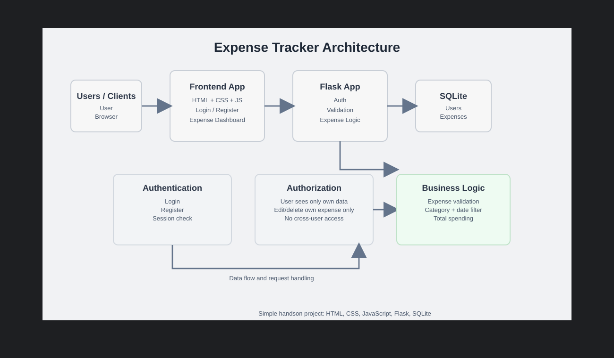
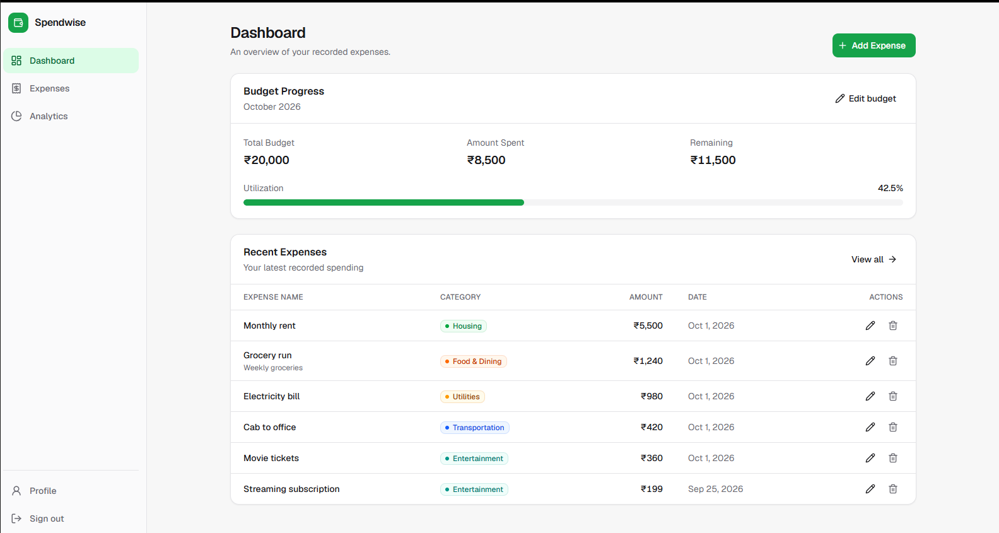
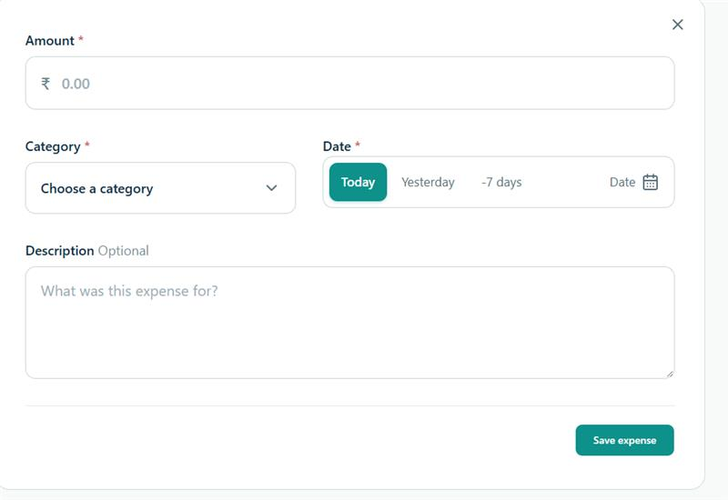
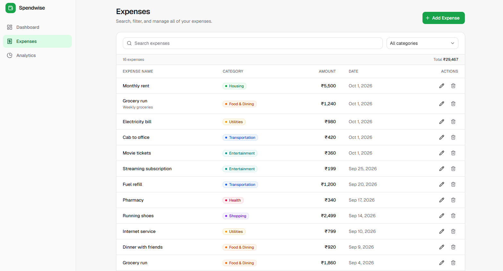
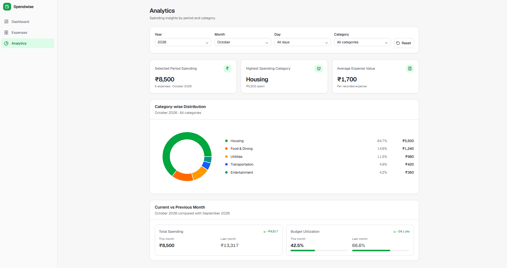
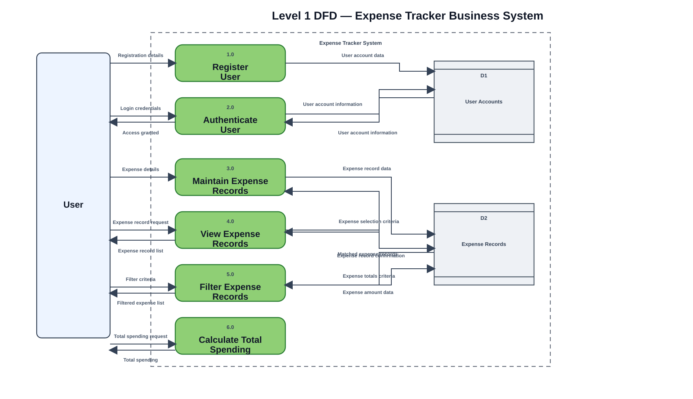

# Visual Design Reference

The current application uses the reference assets in this folder's `visuals`
directory. The running templates and CSS are authoritative if a reference image
does not exactly match current behavior.

## Application flow

The browser uses HTML, CSS, and JavaScript and communicates with Flask.
Flask enforces authentication, validation, and user ownership and reads/writes
SQLite. The database stores users, categories, expenses, and budgets.

## Screens

### Login

Sign-in uses username and password. Registration is available from the login
flow.

### Dashboard

Dashboard shows the current month's budget amount, expense total, remaining
budget, utilization and status, together with recent expenses and budget
controls.

### Expense entry

The Add Expense form places amount across the form, category beside the date
presets/custom picker, then description and save. The selected date also
determines the new expense's date and filters the existing-record preview.
There are no subcategory or expense-type controls.

### Expenses

The Expenses page lists amount, category, date, and description, with a
category filter and edit/delete actions. Add Expense places date presets and a
custom picker beside Category in the entry form. The selected date and category
also filter the existing-record list, totals, and analytics.

### Analytics

Analytics provides year, month, day, and category filters; a category
distribution and period summary; and comparison with the previous full month.
Future months and years are unavailable.

## Data flow visuals

